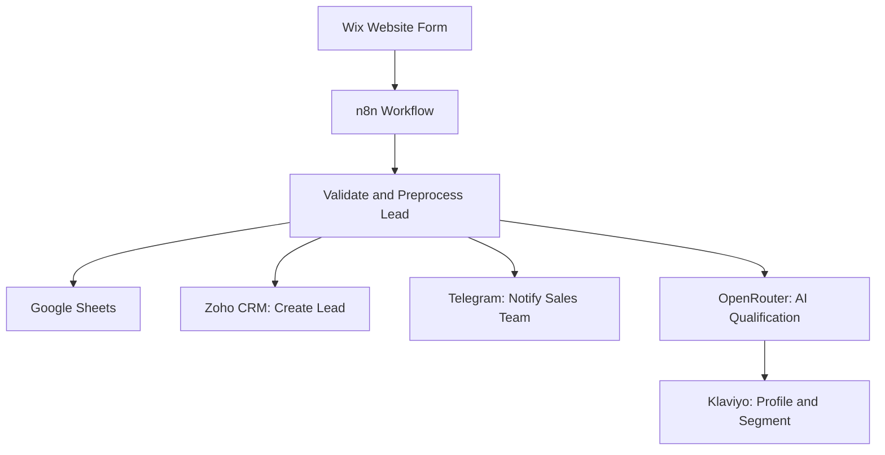

# AI Lead Management & CRM Automation Platform for Spec Montazh

An end-to-end AI-powered lead management solution connecting website lead capture, AI qualification, CRM automation, sales notifications, and marketing segmentation.

**Project type:** Portfolio case study  
**Focus:** AI Automation · Sales Operations · CRM Integration

[View the full portfolio case study](https://app.notion.com/p/portfolio-kovalov/AI-Lead-Management-CRM-Automation-Platform-for-Spec-Montazh-3b5b7f0c14358080b7b7f8ee6200b528?source=copy_link)

## Business Context

Spec Montazh is an engineering company that needed a unified solution for lead generation and automated lead management.

A corporate landing page was developed using Wix and connected to a workflow that integrates lead capture, AI qualification, CRM, sales notifications, and marketing segmentation.

## Business Problem

Before implementing the solution, business tools operated without a unified automation workflow.

Key challenges included:

- Manual lead processing and data transfer between platforms
- No automated AI-based lead qualification or prioritization
- Delayed notifications to the sales team
- Manual or missing marketing segmentation
- Risk of losing leads and introducing data entry errors

These manual operations required sales managers to spend time on repetitive administrative tasks instead of communicating with potential customers.

## Solution Overview

The solution connects the company's Wix website with business applications through an automated workflow orchestrated by n8n.

The system is designed to:

- Capture new inquiries submitted through the website
- Validate and preprocess customer data
- Store lead information in Google Sheets
- Qualify leads using an LLM through OpenRouter
- Create lead records in Zoho CRM via API integration
- Notify the sales team through Telegram
- Create or update customer profiles in Klaviyo
- Assign contacts to appropriate marketing segments based on AI qualification

## Workflow Architecture

*This is a conceptual overview of the business workflow, not an exact export of the n8n node sequence.*

## Workflow Breakdown

### 1. Lead Capture

A potential customer submits an inquiry through the corporate Wix website.

### 2. Data Validation and Processing

The incoming data is validated and preprocessed before being passed to the connected business systems.

### 3. Data Storage

Lead information is recorded in Google Sheets to support data storage and process logging.

### 4. CRM Integration

A new lead is created in Zoho CRM through API integration, centralizing lead information for the sales team.

### 5. AI-Powered Lead Qualification

OpenRouter is used to analyze available lead information and classify purchase intent into three categories:

- **Hot:** The customer is actively looking for a solution or is ready to purchase.
- **Warm:** The customer is interested but may require additional communication.
- **Cold:** The customer has low purchase intent or insufficient information for qualification.

A Structured Output Parser is used to return AI classification results in a standardized format.

### 6. Sales Notifications

The sales team receives Telegram notifications containing key details about new inquiries, enabling managers to respond promptly.

### 7. Marketing Segmentation

Based on AI qualification results, customer profiles are created or updated in Klaviyo and assigned to the appropriate marketing segments.

The Klaviyo integration uses REST API requests to support customer profile creation and segment management.

## Technology Stack

| Technology | Purpose |
|---|---|
| Wix | Corporate landing page and lead capture form |
| n8n | Workflow orchestration and business process automation |
| OpenRouter API | LLM access for AI-powered lead qualification |
| Structured Output Parser | Standardized AI classification output |
| Zoho CRM API | Automated lead creation |
| Google Sheets API | Lead data storage and logging |
| Telegram Bot API | Sales team notifications |
| Klaviyo API | Customer profiles and marketing segmentation |
| REST APIs | Integration between business systems |

## Key Implementation Areas

- Corporate landing page and lead capture form
- End-to-end n8n workflow design
- Data validation and preprocessing
- AI-powered lead qualification
- Structured output handling
- Zoho CRM API integration
- Telegram notifications
- Klaviyo customer profile management and segmentation
- End-to-end workflow testing

## Results

The portfolio case documents the following outcomes:

- **100% of website inquiries** are processed automatically within the documented workflow.
- **Automated CRM creation:** new leads are created in Zoho CRM without manual data entry.
- **Under 30 seconds:** lead processing time, compared with several minutes in the previous manual process, as reported in the case study.
- **AI-powered qualification:** new leads are classified by purchase intent to support marketing segmentation.
- **Unified workflow:** website inquiries, CRM, sales notifications, data storage, and marketing operations are connected.

These figures reflect the results reported in the portfolio case study. They should not be interpreted as independently verified production-scale performance benchmarks.

## Business Value

The solution is designed to:

- Reduce repetitive administrative work
- Eliminate duplicate manual data entry across connected systems
- Improve consistency in lead processing
- Help sales managers respond to new inquiries faster
- Support lead prioritization through AI qualification
- Enable personalized marketing through automated segmentation
- Connect lead acquisition with CRM and marketing workflows

## Security Considerations

When deploying or sharing automation workflows:

- Never commit API keys, access tokens, passwords, or credentials.
- Use n8n credentials or environment variables for sensitive configuration.
- Use synthetic data in public examples.
- Remove customer information, private identifiers, and internal URLs before publishing workflow exports.
- Review all exported workflow JSON files before committing them to a public repository.

## Scope and Limitations

This repository provides documentation of the solution architecture, workflow logic, integrations, and implementation approach for a portfolio case study.

The architecture diagram is conceptual and does not represent the exact sequence of every n8n node.

The business outcomes and processing time described above are based on the portfolio case study and are not presented as independently audited results.

## Portfolio

For the full project description, implementation details, screenshots, and video demonstration, see:

**[AI Lead Management & CRM Automation Platform for Spec Montazh](https://app.notion.com/p/portfolio-kovalov/AI-Lead-Management-CRM-Automation-Platform-for-Spec-Montazh-3b5b7f0c14358080b7b7f8ee6200b528?source=copy_link)**

## Contact

- **Portfolio:** [Dmytro Kovalov on Notion](https://portfolio-kovalov.notion.site/Dmytro-Kovalov-37cb7f0c143580418f56dc674dbe43f5)
- **LinkedIn:** [Dmytro Kovalov](https://www.linkedin.com/in/dmytro-kovalov-431805166/)
- **Telegram:** [@Dmytro_Kova](https://t.me/Dmytro_Kova)
