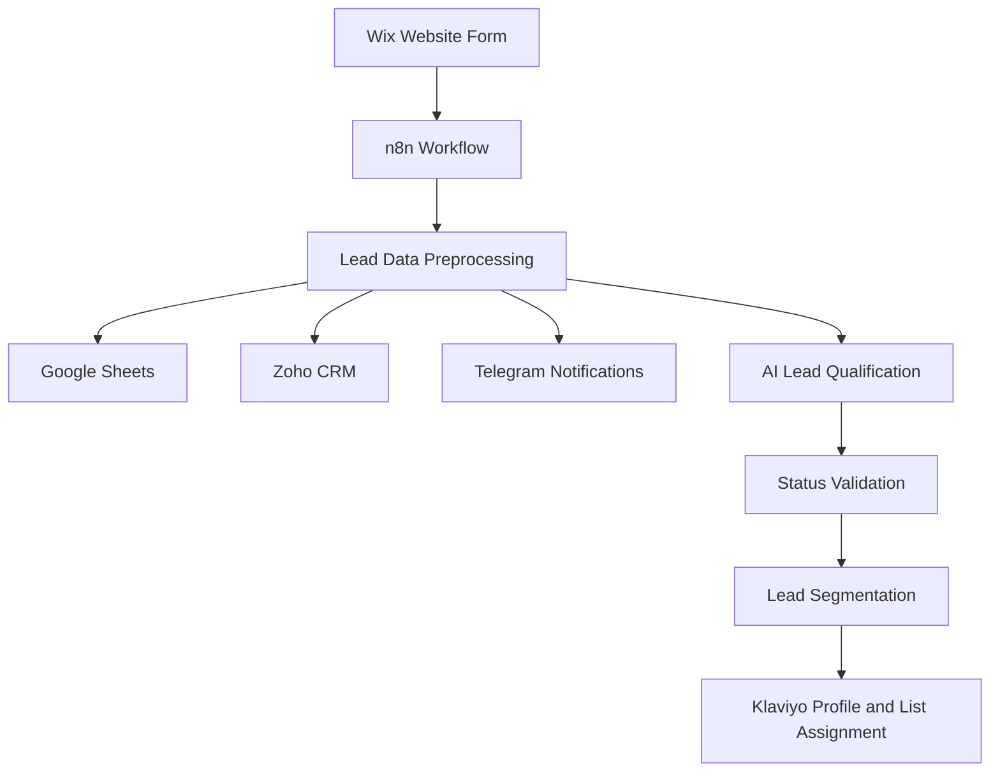

# AI Lead Management & CRM Automation Platform for Spec Montazh

An AI-powered lead management solution connecting website lead capture, AI qualification, CRM automation, sales notifications, and marketing segmentation through an n8n workflow.

**Project type:** Portfolio case study  
**Focus:** AI Automation · Sales Operations · CRM Integration

[View the full portfolio case study in Notion](https://app.notion.com/p/portfolio-kovalov/AI-Lead-Management-CRM-Automation-Platform-for-Spec-Montazh-3b5b7f0c14358080b7b7f8ee6200b528?source=copy_link)

## Business Context

Spec Montazh is an engineering company that needed a unified solution for lead capture and automated lead management.

A corporate landing page was developed using Wix and connected to an n8n workflow integrating lead capture, AI qualification, CRM, sales notifications, and marketing segmentation.

## Business Problem

Before the solution, business tools operated without a unified automation workflow.

Key challenges included:

- Manual lead processing and data transfer between platforms
- No automated AI-based lead qualification or prioritization
- Delayed notifications to the sales team
- Manual or missing marketing segmentation
- Risk of losing leads and introducing data entry errors

These manual operations required sales managers to spend time on repetitive administrative tasks instead of communicating with potential customers.

## Solution Overview

The solution connects the company's Wix website with business applications through an automated workflow orchestrated by n8n.

The workflow is designed to:

- Capture new website inquiries
- Preprocess lead data
- Store lead information in Google Sheets
- Classify lead intent using an LLM through OpenRouter
- Create lead records in Zoho CRM
- Notify the sales team through Telegram
- Create customer profiles in Klaviyo
- Assign contacts to marketing lists based on AI qualification

## Workflow Architecture

*This is a conceptual overview of the workflow, not an exact representation of every n8n node or execution dependency.*

## Workflow Breakdown

### 1. Lead Capture

A potential customer submits an inquiry through the corporate Wix website. The submission is received by an n8n Webhook.

### 2. Data Preprocessing

The workflow extracts the lead's name, surname, email, phone number, and comment from the incoming payload.

### 3. Business System Synchronization

Lead information is sent to three destinations:

- **Google Sheets:** records lead data for tracking and process logging.
- **Zoho CRM:** creates a lead record for the sales team.
- **Telegram:** sends a notification containing the submitted lead details.

### 4. AI-Powered Lead Qualification

An OpenRouter language model analyzes the lead's comment and returns a structured classification.

The workflow uses three categories:

- **Hot:** strong buying intent, urgency, a specific project, budget, timeline, or an immediate request for contact.
- **Warm:** interest in the service or a request for information without clear urgency. Empty comments are also classified as warm.
- **Cold:** general interest, browsing, testing, or no clear intent to buy.

A Structured Output Parser standardizes the model response. A subsequent validation step routes unrecognized statuses to a default status.

### 5. Marketing Segmentation

Based on the qualification result, the workflow maps the lead to a corresponding Klaviyo list, creates a customer profile through the Klaviyo API, and associates the profile with the selected list.

## Technology Stack

| Technology | Purpose |
|---|---|
| Wix | Corporate landing page and lead capture |
| n8n | Workflow orchestration and automation |
| OpenRouter API | LLM access for lead qualification |
| Structured Output Parser | Standardized AI output |
| Zoho CRM API | Automated lead creation |
| Google Sheets API | Lead data storage and logging |
| Telegram Bot API | Sales team notifications |
| Klaviyo API | Customer profiles and list segmentation |
| REST APIs | Integration between business systems |

## Technical Implementation

The repository includes the sanitized n8n workflow export and supporting technical documentation.

- [Sanitized n8n workflow JSON](workflows/leads-save-and-inform.json)
- [Workflow documentation and setup instructions](workflows/README.md)
- [Architecture documentation](docs/architecture.md)
- [Testing plan](docs/testing.md)

The workflow export preserves the node structure and connections while removing execution sample data, credential references, and client-specific resource identifiers. Placeholder values must be configured before running the workflow.

## Key Implementation Areas

- Website form integration and webhook-based lead capture
- Data preprocessing and field mapping
- AI-powered lead qualification
- Structured output parsing and status validation
- Zoho CRM API integration
- Google Sheets data logging
- Telegram sales notifications
- Klaviyo profile creation and list assignment
- Workflow documentation and test planning

## Results

The portfolio case study reports the following outcomes:

- **100% of website inquiries processed automatically** within the documented workflow.
- **Automated CRM creation:** lead records are created in Zoho CRM without manual data entry.
- **Under 30 seconds:** reported lead processing time, compared with several minutes in the previous manual process.
- **AI-powered qualification:** leads are classified by purchase intent to support prioritization and marketing segmentation.
- **Unified workflow:** website inquiries, CRM, notifications, data storage, and marketing operations are connected.

These figures reflect results reported in the portfolio case study. They have not been independently verified as production-scale performance benchmarks.

## Business Value

The solution is designed to:

- Reduce repetitive administrative work
- Reduce manual data transfer between connected systems
- Improve consistency in lead processing
- Help sales managers respond to new inquiries faster
- Support lead prioritization through AI qualification
- Enable marketing segmentation based on lead intent
- Connect lead acquisition with CRM and marketing workflows

## Security Considerations

The public workflow export has been sanitized for portfolio use.

- Credentials and execution sample data have been removed.
- Client-specific resource identifiers have been replaced with placeholders where appropriate.
- API keys, access tokens, passwords, and customer data must never be committed to a public repository.
- Credentials should be configured securely in n8n.
- Workflow exports should be reviewed before publication.

## Scope and Limitations

This repository documents the workflow configuration, architecture, integrations, and implementation approach for a portfolio case study.

The architecture diagram is conceptual and does not represent every node-level dependency.

The testing document describes planned test scenarios; it should not be interpreted as evidence that all scenarios have passed.

Reported business outcomes and processing times are based on the portfolio case study and are not independently audited.

## Portfolio

For the full project description, implementation details, screenshots, and video demonstration, see:

**[AI Lead Management & CRM Automation Platform for Spec Montazh](https://app.notion.com/p/portfolio-kovalov/AI-Lead-Management-CRM-Automation-Platform-for-Spec-Montazh-3b5b7f0c14358080b7b7f8ee6200b528?source=copy_link)**

## Contact

- **Portfolio:** [Dmytro Kovalov on Notion](https://portfolio-kovalov.notion.site/Dmytro-Kovalov-37cb7f0c143580418f56dc674dbe43f5)
- **LinkedIn:** [Dmytro Kovalov](https://www.linkedin.com/in/dmytro-kovalov-431805166/)
- **Telegram:** [@Dmytro_Kova](https://t.me/Dmytro_Kova)
